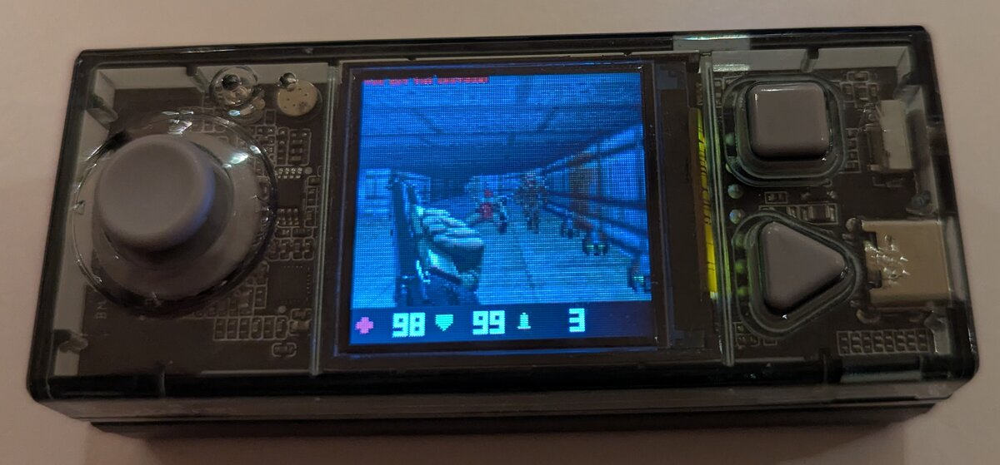
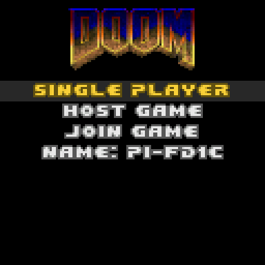
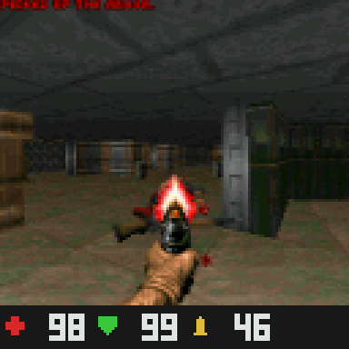
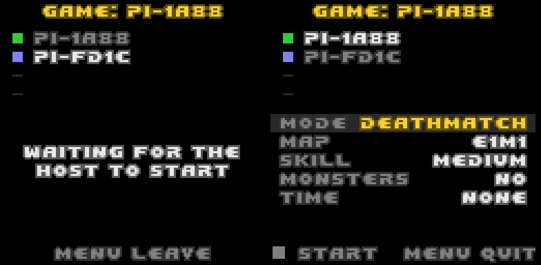
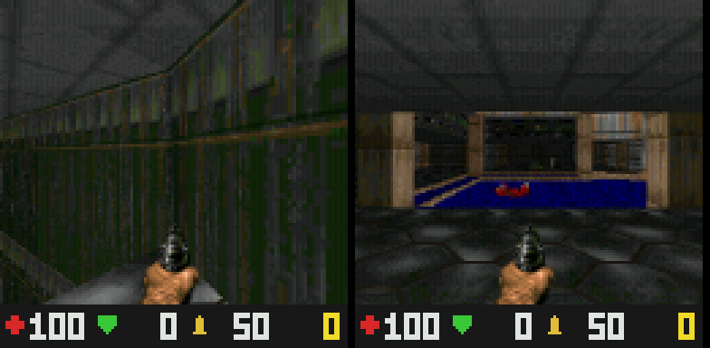
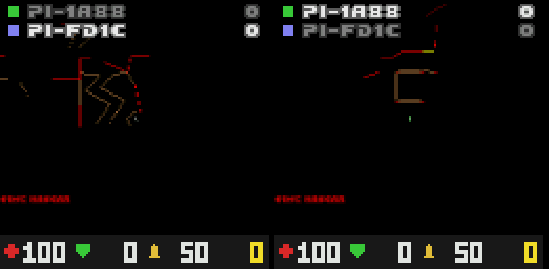

The [Makeblock CyberPi](https://www.makeblock.com/) is a learning gadget for kids: a 128×128 colour screen, a joystick, two buttons, a speaker and five RGB LEDs, programmed with Scratch-style blocks. Inside is an ESP32 with 8 MB of flash and 8 MB of PSRAM, which is clearly enough for Doom. So of course it now runs Doom, and two or more of them can play deathmatch against each other.

It's shareware Doom at around 30 frames per second, with sound effects and music, saved games, and network games for up to four CyberPis. You can [install it from your browser](/tools/cyberpi-doom/), and the source is [on GitHub](https://github.com/the-parts-bin/cyberpi-doom).

## Doom in 128 pixels

The port starts from [doomgeneric](https://github.com/ozkl/doomgeneric), which reduces Doom's platform layer to a handful of functions: draw a frame, read keys, tell the time. Doom draws 320 columns, and the screen has 128. Rather than crop the sides and lose field of view, it renders in Doom's low-detail mode, which computes 160 columns, and those are scaled down to 128 with a box filter.

The screen is square, and Doom's picture isn't, so there's room to spare vertically. Doom renders 320×232 instead of 320×200, which adds view above and below without narrowing the field of view. Doom's own status bar is unreadable at this size, so health, armor, ammo and keys get a compact HUD drawn at the panel's resolution.

The ESP32 has two cores. Doom runs on one. The other scales each frame and sends it to the LCD, and mixes the sound: effects, plus the music played through an emulated OPL2 chip, the FM synthesizer on the sound cards Doom was written for. The speaker is driven by the ESP32's 8-bit DAC behind an amplifier loud enough that a single step of the DAC is audible. To keep quiet music from turning into hiss, the DAC runs at 352.8 kHz with noise shaping, pushing the rounding noise (mostly) above what you can hear.

## Deathmatch

For network games, one CyberPi hosts: it becomes a Wi-Fi access point named after the game, and the others find it in their Join Game list. Everyone gathers in a lobby, where the host picks the mode, level and skill and starts the game.

Under the lobby it's [Chocolate Doom](https://www.chocolate-doom.org/)'s netcode, unchanged, over UDP. Doom's networking is lockstep: every machine runs the same simulation from everyone's inputs, so everybody plays at the pace of the slowest CyberPi, between 18 and 30 frames per second depending on the view. The map shows everyone's frags.

## Try it

The [web installer](/tools/cyberpi-doom/) works in Chrome or Edge on a computer, with the CyberPi on USB:

1. **Back up first.** This saves the CyberPi's original firmware, and it's the only way to get it back.
2. **Install**, with the shareware `doom1.wad` from Doom v1.9. It's freely available, for example from Linux distributions' `doom-shareware` packages, but not included.
3. **Restore** puts the backup back whenever you want the CyberPi to be a CyberPi again.

For command-line flashing, building it yourself and all the details, see the [repository](https://github.com/the-parts-bin/cyberpi-doom).
